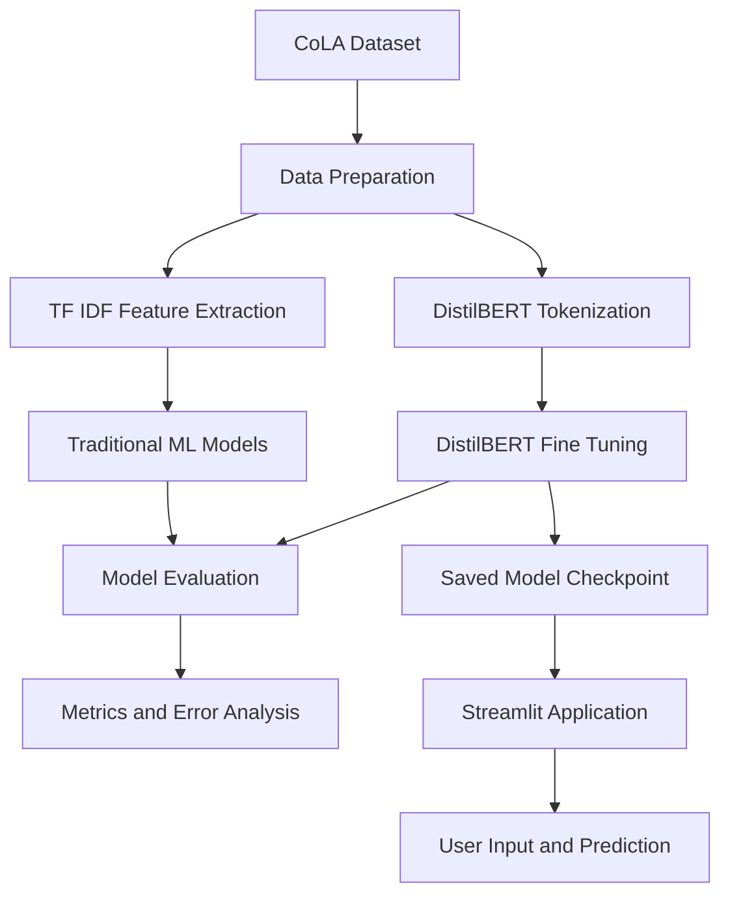

# Research Manuscript Quality Analyzer

A machine learning project that analyzes the linguistic acceptability of English sentences using traditional machine learning models and a fine tuned DistilBERT transformer.

The application allows users to enter a sentence or paragraph and receive a prediction indicating whether the text is linguistically acceptable or unacceptable.

**Project status:** Under development

## 1. Overview

The Research Manuscript Quality Analyzer explores how natural language processing and machine learning can support sentence level linguistic analysis in research writing.

The project uses the Corpus of Linguistic Acceptability (CoLA) dataset to train and evaluate models that classify English sentences according to their linguistic acceptability.

It includes traditional machine learning approaches using TF IDF features and a transformer based approach using DistilBERT. A Streamlit interface provides an interactive way to test the trained DistilBERT model.

**Important scope clarification:** This project evaluates linguistic acceptability only. It does not verify research facts, scientific methodology, citations, plagiarism, originality, or the overall quality of an academic manuscript.

## 2. Objectives

1. Build a reproducible NLP classification pipeline using the CoLA dataset.
2. Establish a baseline using TF IDF and Logistic Regression.
3. Compare traditional machine learning models with DistilBERT.
4. Evaluate models using accuracy, macro precision, macro recall, macro F1 score, and confusion matrices.
5. Investigate class imbalance and improve the detection of unacceptable sentences.
6. Develop a Streamlit application for interactive predictions.
7. Document model limitations and maintain a clear separation between linguistic acceptability and broader manuscript quality.

## 3. Dataset

**Dataset:** Corpus of Linguistic Acceptability (CoLA)

**Source:** [GLUE benchmark dataset on Hugging Face](https://huggingface.co/datasets/nyu-mll/glue)

CoLA contains English sentences labeled according to their linguistic acceptability.

| Label | Meaning |
|---|---|
| 0 | Unacceptable sentence |
| 1 | Acceptable sentence |

### Dataset preparation

The project uses the CoLA training and validation data for model development and evaluation.

A stratified split was also created from the labeled training data to reserve an independent holdout set for final evaluation.

| Split | Samples | Purpose |
|---|---:|---|
| Development dataset | 7,242 | Model development |
| Final holdout dataset | 1,279 | Final DistilBERT evaluation |

The development dataset was divided into 6,155 training samples and 1,087 internal validation samples for the final DistilBERT experiment.

The official CoLA test labels are not used for labeled performance evaluation because they are provided as unavailable labels in the downloaded dataset.

## 4. Technology Stack

| Category | Technologies |
|---|---|
| Programming language | Python |
| Data processing | Pandas, NumPy |
| Traditional machine learning | Scikit learn |
| Text representation | TF IDF, word and character features |
| Transformer model | DistilBERT |
| Deep learning | PyTorch |
| NLP and model utilities | Hugging Face Transformers, Datasets |
| Application interface | Streamlit |
| Model persistence | Joblib, PyTorch model checkpoints |
| Development environment | Jupyter Notebook, Python virtual environment |
| Version control | Git, GitHub |

## 5. Models Implemented

### 5.1 DistilBERT

DistilBERT is a compact transformer model used for contextual sentence classification.

Unlike traditional TF IDF models, DistilBERT generates contextual representations of text. The project uses a sequence classification head to predict linguistic acceptability.

Experiments included different learning rates, training durations, and class weighting strategies.

The final experiment used class weighted training to address the imbalance between acceptable and unacceptable sentences.

### 5.2 Logistic Regression with TF IDF

Logistic Regression serves as the initial traditional machine learning baseline.

TF IDF converts sentences into numerical feature vectors before classification. The initial baseline used no class weighting, which resulted in a strong preference for the majority acceptable class.

### 5.3 Linear Support Vector Machine with Word TF IDF

This experiment uses word level TF IDF features with a Linear Support Vector Machine classifier.

It provides a traditional machine learning comparison against Logistic Regression and DistilBERT.

### 5.4 Linear Support Vector Machine with Word and Character TF IDF

This experiment combines word and character TF IDF features.

Word features capture lexical information, while character features can capture subword patterns, spelling variations, and morphological information.

The experiment achieved a slightly higher accuracy and macro F1 score than the word only SVM configuration.

## 6. Model Evaluation and Comparison

The following table is sorted by reported accuracy, from highest to lowest.

| Model | Evaluation split | Accuracy | Macro Precision | Macro Recall | Macro F1 |
|---|---|---:|---:|---:|---:|
| DistilBERT, learning rate 2e-5, 2 epochs | Earlier validation | 80.12% | 77.68% | 73.45% | 74.91% |
| DistilBERT, learning rate 1e-5, 3 epochs | Earlier validation | 79.73% | 77.61% | 72.30% | 73.95% |
| Final weighted DistilBERT, learning rate 1e-5 | Final holdout | 78.73% | 75.28% | 70.55% | 72.06% |
| Logistic Regression with TF IDF, unweighted | Validation | 69.69% | 64.62% | 51.74% | 46.00% |
| Word and Character TF IDF with Linear SVM | Validation | 64.29% | 57.51% | 57.23% | 57.34% |
| Word TF IDF with Linear SVM | Validation | 64.19% | 57.17% | 56.81% | 56.94% |

**Evaluation note:** The traditional machine learning models were evaluated on 1,036 validation samples. The final DistilBERT model was evaluated on a separate holdout containing 1,279 samples. The earlier DistilBERT validation results also come from different experiments. These results should not be interpreted as a strict same split benchmark.

The earlier DistilBERT checkpoints may have encountered some sentences in the newly created holdout during previous training. Therefore, their earlier validation scores are not presented as independent holdout results.

### Interpretation

DistilBERT achieved the highest reported accuracy among the listed experiments. Its final holdout accuracy was 78.73%, with a macro F1 score of 72.06%.

The unweighted Logistic Regression baseline achieved 69.69% accuracy, but its macro F1 score was only 46.00%. This illustrates why accuracy alone is insufficient for an imbalanced classification problem.

Combining word and character TF IDF features produced a small improvement over the word only SVM experiment.

A controlled comparison using the same development and evaluation splits would provide a more reliable basis for ranking all model families.

## 7. Final DistilBERT Holdout Evaluation

The final DistilBERT experiment was trained on the development dataset using an internal training and validation split. The reserved holdout was used for final evaluation.

### Configuration

| Parameter | Value |
|---|---|
| Base model | DistilBERT base uncased |
| Dataset | CoLA |
| Training samples | 6,155 |
| Internal validation samples | 1,087 |
| Final holdout samples | 1,279 |
| Learning rate | 1e-5 |
| Maximum epochs | 4 |
| Class weighting | Enabled |
| Best internal validation macro F1 | 73.95% |
| Selected checkpoint | Best internal validation checkpoint |
| Training time | Approximately 1,100.70 seconds |

The best internal validation macro F1 score was obtained at epoch 3. The score decreased slightly at epoch 4, so the best checkpoint was retained.

### Final holdout metrics

| Metric | Score |
|---|---:|
| Accuracy | 78.73% |
| Macro Precision | 75.28% |
| Macro Recall | 70.55% |
| Macro F1 | 72.06% |

### Confusion matrix

Rows represent actual labels, and columns represent predicted labels.

| Actual / Predicted | Unacceptable (0) | Acceptable (1) |
|---|---:|---:|
| Unacceptable (0) | 191 | 187 |
| Acceptable (1) | 85 | 816 |

### Class level performance

| Class | Precision | Recall | F1 score | Support |
|---|---:|---:|---:|---:|
| Unacceptable (0) | 69% | 51% | 58% | 378 |
| Acceptable (1) | 81% | 91% | 86% | 901 |

The model performs better at identifying acceptable sentences than unacceptable sentences. It correctly identified 191 of the 378 unacceptable sentences in the final holdout.

This remains an important limitation because a linguistic acceptability checker should not overlook a large proportion of potentially unacceptable sentences.

## 8. Application Features

The Streamlit application provides an interactive interface for testing the trained DistilBERT model.

Current features include:

1. Sentence or paragraph input.
2. Linguistic acceptability classification.
3. Predicted class label.
4. Display of model confidence scores.
5. A simple interface for testing different text examples.

The displayed scores are model softmax outputs and should not be interpreted as calibrated probabilities.

The application is intended as a prototype for linguistic analysis rather than an automated academic review or manuscript approval system.

## 9. Project Workflow



## 10. Project Structure

```text
research_manuscript_quality_analyzer/
│
├── app.py
├── main.py
├── requirements.txt
├── README.md
├── .gitignore
│
├── data/
│   ├── raw/
│   └── processed/
│       └── final_evaluation/
│
├── models/
│   ├── logistic_regression.pkl
│   └── distilbert_final/
│
├── notebooks/
│
├── reports/
│   ├── baseline/
│   └── distilbert_final/
│
├── src/
│   ├── preprocessing.py
│   ├── predict.py
│   ├── predict_distilbert.py
│   ├── create_final_split.py
│   └── train_distilbert_final.py
│
└── tests/
```

The structure above illustrates the main project components. Actual filenames and subdirectories may differ as development continues.

The dataset and trained model artifacts are excluded from the Git repository because they can be large. They must be downloaded or generated locally before running the corresponding model pipelines.

## 11. Installation and Setup

### Prerequisites

Install Python and Git. A Python virtual environment is recommended.

Clone the repository:

```bash
git clone https://github.com/aryangaikwadgit/research_manuscript_quality_analyzer.git
cd research_manuscript_quality_analyzer
```

Create and activate a virtual environment on Windows PowerShell:

```powershell
python -m venv .venv
.\.venv\Scripts\Activate.ps1
```

Install the dependencies:

```powershell
python -m pip install -r requirements.txt
```

### Running the application

Download or prepare the required dataset and ensure the trained DistilBERT checkpoint is available at the path configured in `app.py`.

Start the Streamlit application:

```powershell
python -m streamlit run app.py
```

Streamlit will display a local URL in the terminal. Open that URL in your browser to test the application.

### Training and evaluation

The project contains scripts for traditional machine learning and DistilBERT experiments.

The traditional Logistic Regression pipeline can be run using:

```powershell
python main.py
```

The final DistilBERT training script is:

```powershell
python src/train_distilbert_final.py
```

**Note:** Training DistilBERT takes substantially longer than running the application. The final model checkpoint is not included in the public repository, so it must be generated or made available locally before inference.

## 12. Limitations

1. **Narrow task scope:** The model evaluates linguistic acceptability, not complete manuscript quality.
2. **Class imbalance:** Acceptable sentences are more common than unacceptable sentences in the evaluation data.
3. **Unacceptable sentence detection:** The final DistilBERT model misses a substantial number of unacceptable examples.
4. **Dataset limitations:** CoLA is a linguistic acceptability dataset and does not represent every writing issue found in academic manuscripts.
5. **Confidence calibration:** Softmax outputs are not guaranteed to represent calibrated probabilities.
6. **Evaluation comparability:** Some experiments use different validation or holdout splits.
7. **No factual verification:** The application does not validate scientific claims, experimental results, or references.
8. **No plagiarism detection:** Similarity checking, source verification, and plagiarism analysis are outside the current implementation.

## 13. Future Improvements

Planned improvements include:

1. Evaluate all traditional models on the same reserved holdout split where feasible.
2. Add class weighted Logistic Regression and compare it with the existing baseline.
3. Improve recall for unacceptable sentences while monitoring precision and overall performance.
4. Conduct systematic error analysis on false positives and false negatives.
5. Explore additional linguistic features and suitable NLP models.
6. Add automated evaluation reports and clearer experiment tracking.
7. Improve the Streamlit interface and prediction explanations.
8. Add unit tests and document model setup and reproduction steps.
9. Investigate whether domain specific academic writing data improves performance without changing the defined task.

## 14. Responsible Use

The application should be used as an experimental linguistic assistance tool.

Predictions are not definitive judgments about writing quality. A sentence classified as acceptable may still contain factual, methodological, citation, or stylistic problems. Similarly, an unacceptable prediction should be reviewed in context.

Human review remains necessary for academic and professional writing decisions.

## 15. Development Status

The project currently includes data preparation, traditional machine learning experiments, DistilBERT fine tuning, final holdout evaluation, and a Streamlit prediction interface.

The project remains under development. Evaluation consistency, error analysis, and improvements in unacceptable sentence detection are areas for further work.

## 16. Repository

GitHub: https://github.com/aryangaikwadgit/research_manuscript_quality_analyzer

